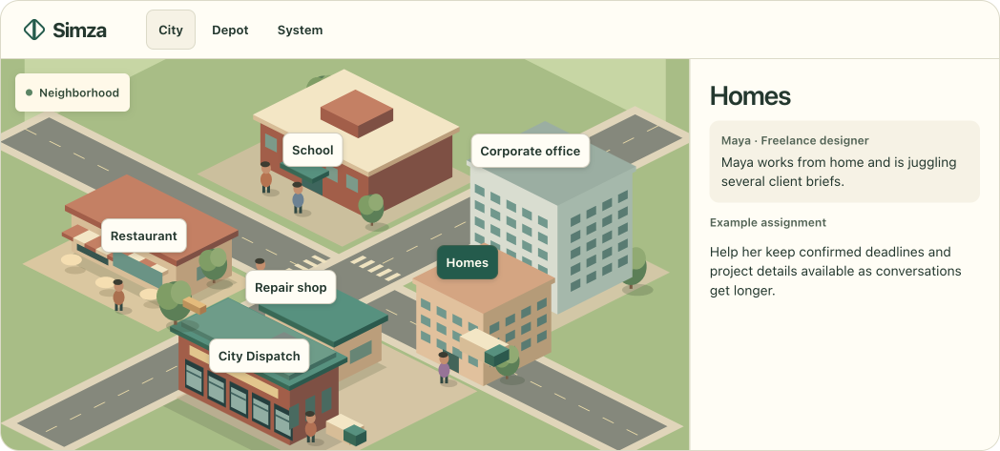
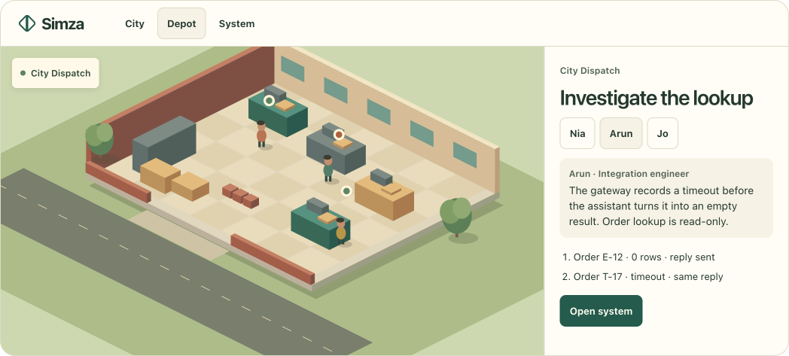
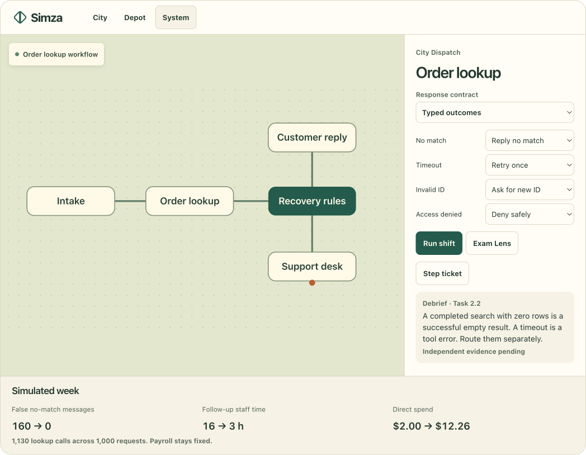
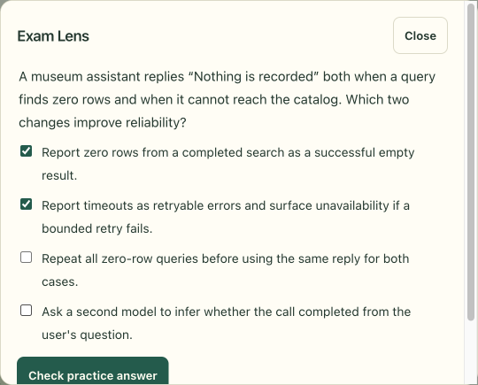

# C · Visual direction

**Art brief and reference dossier · November 12, 2026**

## Direction

A warm isometric city with residential streets, restaurants, small shops, schools, corporate offices and public spaces. Show the routines that distinguish them. People wait outside a restaurant, a school gathers around its entrance, and a repair shop serves the street through its storefront. City Dispatch sits on the same neighborhood map as one of the places a player can visit. Use the color and glanceable composition of early FarmVille, the life and volume of later variants, and the information discipline of a transit diagram. Use distinct silhouettes and street-level details for different institutions. Playable interiors become readable cutaways with the people and stations relevant to the current assignment. The system overlay uses the same stations and names. [Zynga FarmVille case study, 2010](https://media.gdcvault.com/GD_Mag_Archives/GDM_August_2010.pdf), [Zynga FarmVille 2 launch, 2012](https://www.globenewswire.com/news-release/2012/09/05/489072/19100/en/zynga-reimagines-social-games-with-the-launch-of-farmville-2.html), [Two Point Hospital](https://store.steampowered.com/app/535930/Two_Point_Hospital/), [Mini Metro](https://store.steampowered.com/app/287980/Mini_Metro/)

## FarmVille reference shots and footage

Open the linked screenshots and footage as a side-by-side reference board. Screenshots describe visible presentation. Camera settings, measurements and animation guidance below are CertCity proposals.

| Reference | What to look at | Application to CertCity |
|---|---|---|
| **FarmVille, 2009 Facebook** · [Zynga screenshots in developer article, August 2010](https://media.gdcvault.com/GD_Mag_Archives/GDM_August_2010.pdf), [launch-era screenshot and interview, October 2009](https://www.sfgate.com/homeandgarden/article/farmville-becomes-social-media-powerhouse-3213773.php), [archival screenshot](https://www.pcgamer.com/end-of-an-era-farmville-is-finally-being-put-out-to-pasture/), [2010 walkthrough page](https://social-games.wonderhowto.com/how-to/play-farmville-facebook-with-few-basics-333777/) | Fixed high oblique presentation. Sprite-like depth and short shadows. Bright grass against flat tilled plots. Tiny worker compared with buildings. Strong repeated units make ready and empty plots readable. At high density, cash controls, toolbars and neighbor entries frame the work. The walkthrough documents point-and-click plow, plant and move tools. | Use consistent ground units and a calm field around the active place. Adopt decisive shapes for state changes and local acknowledgment. Preserve open working space as props and progress accumulate. The linked walkthrough is historical and its embedded playback may depend on archive availability. The [2010 iPhone launch report and images](https://techcrunch.com/2010/06/23/farmville-iphone/) document the classic design on touch and a shared Facebook farm. |
| **FarmVille 2, 2012 browser** · [Zynga screenshot gallery](https://www.zynga.com/games/farmville-2/), [official behind the scenes](https://www.youtube.com/watch?v=nnNKko2ELKQ), [official introduction](https://www.youtube.com/watch?v=gSXvhYZtjnc) | Modeled volume and softened edges. More differentiated foliage, materials and shadows. Animated crops, characters and animals give the farm several scales of movement. Buildings remain larger silhouettes on an oblique field. With detail and idle activity comes more competition for attention. | Bake appealing light and depth from a master scene. Give one relevant worker or device a state change per action. Use a quiet area around the decision target. |
| **FarmVille 2: Country Escape, 2014 mobile** · [Zynga screenshots](https://www.zynga.com/games/farmville-2-country-escape/), [gameplay preview, TouchGameplay](https://www.youtube.com/watch?v=p7pt5Q67PkQ), [launch interview](https://time.com/65918/farmville-mobile/) | Bigger contextual targets, touch navigation and dense but readable objects. Close scale emphasizes farmhands and stations. Order fulfillment gives workshops and crops a reason to work together. Market, progress and order controls have specific destinations. | Use tap to inspect and select as primary. Support swipe/pan with an explicit affordance and keep the active task prominent. Move scene controls outside the decision text on a narrow screen. |
| **FarmVille 3, 2021 mobile** · [Zynga game page](https://www.zynga.com/games/farmville-3/), [official launch and media](https://www.zynga.com/corporate/farmville-3-is-now-available-worldwide/), [App Store feature and images](https://apps.apple.com/us/iphone/story/id1596527003) | Rounded models, brighter character accents, stronger silhouettes and animation emphasizing distinct animals and workers. Progress takes shape through unlocks, new animals, assignments and a growing cast. Promotional poses are more expressive than the at-scale gameplay view. | Make roles recognizable by pose, apron or tool and by a named location. Use a portrait at conversation scale. Test actual gameplay-camera sprites as the approval target. |
| **Tropic Escape, 2016 mobile** · [Zynga screenshots](https://www.zynga.com/games/farmville-tropic-escape/) | Warm coastal palette, distinct resort silhouettes and geographic edges organize an altered theme around a familiar production loop. | Make institutions place-specific through restaurant awnings, school courtyards, apartment stoops and delivery bays. Keep shared navigation and state symbols consistent across settings. |

**The emotional target** is a place the player understands, can improve, and wants to check on. A support queue resolving is the equivalent of ripe fields becoming visibly productive. Stage this with objects and people that move because of the outcome. Hold the camera during critical feedback so the player can look back and compare. A short sound, an icon and a changed state support the same moment. Claims about attachment, ownership and satisfaction are hypotheses to test with the target audience. [Zynga FarmVille 2 launch](https://www.globenewswire.com/news-release/2012/09/05/489072/19100/en/zynga-reimagines-social-games-with-the-launch-of-farmville-2.html), [Sailer and Homner, 2020](https://d-nb.info/1202307655/34)

## Comparative mood board

Each store page includes publisher-supplied screenshots or trailers. Observations are design readings of the presentation and mechanics.

| Reference | Borrow | Leave out of the first district |
|---|---|---|
| [Two Point Hospital](https://store.steampowered.com/app/535930/Two_Point_Hospital/) and [Two Point Campus](https://store.steampowered.com/app/1649080/Two_Point_Campus/) | Cutaway rooms, movement between roles, queues and service visibly occupying the same scene. Campus makes identity legible at the institution scale. | Multiple management overlays and attention split across many simultaneous departments. |
| [The Sims 4 Build Mode footage](https://www.ea.com/en-gb/games/the-sims/the-sims-4/media-hub/media/the-sims-4-build-mode-official-gameplay-trailer) | Cutaway transitions make a building and its interior feel continuous. | Broad construction mode, wall occlusion and a free camera competing with the job. |
| [Mini Metro](https://store.steampowered.com/app/287980/Mini_Metro/) | Distinct station shapes, direct route editing, queue growth that shows the failure. | A full-time schematic as the place identity, or a time-pressure fail state for novices. |
| [Factorio](https://store.steampowered.com/app/427520/Factorio/) and [Good Company](https://store.steampowered.com/app/911430/Good_Company/) | Follow one item through multiple dependencies. Use a stalled item to direct attention. Good Company's benches bring a human scale. | Conveyor treatment on every topic and dense production logistics. |
| [Stardew Valley](https://store.steampowered.com/app/413150/Stardew_Valley/) | A small, learnable geography, specific characters and quiet ambient routines. | Real-time or day-length scheduling for study and pixel resolution as a fixed requirement. |
| [RollerCoaster Tycoon Classic](https://store.steampowered.com/app/683900/RollerCoaster_Tycoon_Classic/) | Readable isometric silhouette and miniature-scale consequences such as a queue. | Dense floating inspection windows and small icon-only controls. |
| [Game Dev Tycoon](https://store.steampowered.com/app/239820/Game_Dev_Tycoon/) and [Software Inc.](https://store.steampowered.com/app/362620/Software_Inc/) | A business growing around visible specialists, decisions and workspaces. | Hidden genre optimization or micromanaging every employee's schedule. |
| [Project Highrise](https://store.steampowered.com/app/423580/Project_Highrise/) | Cross-section that reveals service dependencies and spaces where capacity is used. | Unrelated tenant and utility systems. |
| [Township](https://playrix.com/games/township/) and [Hay Day](https://supercell.com/en/games/hayday/) | Legible district identity and direct production feedback on touch screens. | Multi-currency rewards, complex live event chrome and timers whose purpose is return pressure. |

## Camera, scale and palette

- **Camera.** Start with a 45° plan yaw and a 30° downward pitch for a 2:1 dimetric ground diamond, using an orthographic master. In illustration, reserve latitude to choose a slightly steeper interior if it improves sightlines. A fixed heading gives consistent landmarks and asset bakes. Offer two meaningful zoom levels and a reset-to-assignment control. Crossfade exterior to the registered cutaway using the same origin. Use recognizable anchors such as a school entrance, restaurant terrace or depot loading doors. [Phaser tilemap guidance](https://docs.phaser.io/phaser-editor/scene-editor/game-objects/tilemap-object), [Blender camera docs](https://docs.blender.org/manual/en/latest/render/cameras.html), [The Sims Build Mode](https://www.ea.com/en-gb/games/the-sims/the-sims-4/media-hub/media/the-sims-4-build-mode-official-gameplay-trailer)
- **Scale.** Start with 96×48 ground cells at design zoom, 4×3 or 5×4 cell buildings, one-cell service paths, and an on-screen worker height around 38–46 px at institution zoom. Preserve doors and workstation reach. Compact architectural proportions and lightly exaggerated character silhouettes should make roles readable without relying on oversized heads. Reserve foreground cutaway walls below the work surface and use separate roof groups. These dimensions are prototype targets. [Zynga FarmVille 2 screenshots](https://www.zynga.com/games/farmville-2/), [Two Point Hospital](https://store.steampowered.com/app/535930/Two_Point_Hospital/)
- **Art materials.** Warm sand pavement `#E1D6BE`, terracotta brick `#AC6650`, deep blue-green trim `#245C5A`, muted park green `#8FAF79`, cream interior `#F7F2E7`, ink `#223530`. Reserve amber for waiting or retries, and maroon with a stop glyph for policy blocks. Use soft upper-left directional light, gentle right-wall falloff, short consistent ground shadows and matte materials. Use subtle grain in hero renders only if it survives target zoom. [Zynga FarmVille 2 screenshots](https://www.zynga.com/games/farmville-2/), [WCAG 2.2](https://www.w3.org/TR/WCAG22/)
- **Type.** Use Instrument Sans for headings and UI and IBM Plex Mono for payloads, paths and fixed-width counters. Target 16 px task and dialogue text and 14 px secondary labels at browser default zoom. Verify body text contrast at 4.5:1 and essential nontext controls at 3:1 where the standard applies. Pair status with text, shape and motion. Preserve the hierarchy on mobile and at 200% zoom. [WCAG 2.2](https://www.w3.org/TR/WCAG22/)

## Screen and interaction specification

| Surface | Composition and default action | Important states |
|---|---|---|
| **City and mission selection** | Start on a mixed-use block with a restaurant, school, corporate office, small shop, homes and a delivery depot. Selecting a place or resident reveals what happens there and surfaces available assignments. The depot carries the first playable job. On narrow devices, show the city with a selectable location list. | Unseen, in progress, resolved and follow-on available. A saved project changes the workplace and makes a short project card available. |
| **Institution** | Fixed cutaway with a loading floor, request desk and support area. Compact mission goal and one context drawer. A reachable case list mirrors canvas hotspots. | Hover, keyboard focus and touch selection use the same outline and label. Affected desks show the queue. Repaired and pending states look distinct with labels. |
| **Conversation** | Named stakeholder, role and original portrait in a drawer anchored to their station. Start with two to four question choices and a link to the referenced case. Allow free text in the dialogue experiment. | Speaking, response unavailable with authored fallback, fact discovered, close and return focus. Avoid a modal that hides the evidence. |
| **System view and actions** | Schematic overlay or adjacent sheet for the same station names. On desktop, a live route and event inspector share the viewport. On touch, stack them. Select a condition and assign the route with a labeled control. | Draft, compatible target, rejected route with reason, undo, and saved policy. A click or touch equivalent supports all drag interactions. |
| **Playback** | Place one token per visible trace on the active line and show its labeled status. Provide Run Shift, step, pause and skip to results. | Pending, success, retry, handoff, safely denied. A tooltip is supplementary to the event list. Motion does not gate progress. |
| **Impact** | Before/after for false no-match, hours and direct spend, followed by assumptions and example events. Make the simulation period visible. | No run yet, changed, tied, and validation failure. Use neutral comparison copy if two outcomes trade off. |
| **Exam Lens** | Optional button in the system view and debrief. A short practice question in a distinct panel shows exact response count. | Unanswered, submitted, explanation, close with focus restored. Opening marks practice exposure. |
| **Codex and readiness** | Codex opens to the concept learned and official term. Evidence view shows assessed concepts, missing evidence and delayed check. Separate this route from impact. | New, assisted practice, first-seen independent evidence, retained evidence, stale version, insufficient coverage. Avoid treating a single success as full exam readiness. |
| **Progression and unlocks** | Portfolio lists projects, durable improvements and the next real assignment. Use a visual change in the institution as the reward. | New project, saved state, next challenge, replay with prior attempt visible. |

**Timing and sound.** Prototype a 100–150 ms selection acknowledgement, approximately 200 ms snap or route-change transition, and playback at readable manual or accelerated speeds. A brief click, soft mechanical arrival sound and a distinct fault sound can reinforce actions. Keep ambient street and workplace activity at low prominence and audio off until user interaction. Use mute and reduced motion options. With reduced motion, replace travel with one state update and retain the ordered trace. Follow WCAG 2.2 keyboard and pointer requirements and offer a scene-free route to every graded action. [Shute, 2008](https://myweb.fsu.edu/vshute/pdf/shute%202008_b.pdf), [W3C WCAG 2.2](https://www.w3.org/TR/WCAG22/), [W3C dragging alternatives](https://www.w3.org/WAI/WCAG22/Understanding/dragging-movements)

## Production and approval

1. **Graybox in a master scene.** Block the mixed-use street and depot cutaway, three stations, one character rig and one synthetic request. Use orthographic Blender renders with a common scale, pivot and light rig. Share reusable building kits, door widths, storefronts, awnings, floor tiles, desks and signage proportions. Compare 2D painted and 3D-baked treatments at the real view size. [Blender camera docs](https://docs.blender.org/manual/en/latest/render/cameras.html), [Blender LTS](https://www.blender.org/releases/4-5/)
2. **Bake modular layers.** Export ground, wall, roof, props, character frames, shadows and state overlays. Separate surfaces players must see behind. Export atlases with transparent padding and a manifest containing footprint, anchor, depth group, hit polygon, animation frame timings and accessible name. Sort by projected feet and explicitly order intersecting props. Use a short Tiled or JSON layout for repeatable scene geometry. Store high-resolution masters separately from hashed runtime assets. [Tiled map orientations](https://github.com/mapeditor/tiled/blob/master/docs/manual/introduction.rst), [Phaser sprite docs](https://docs.phaser.io/phaser/concepts/gameobjects/sprite)
3. **Animate states.** Share a small set of idle, walk, inspect, process and blocked animations. The queue, scanner and support desk should react only to events. Keep any idle movement gentle and outside the focal area while editing. Introduce a second character with the same rigs and lighting before scaling the cast. [FarmVille 2 behind the scenes](https://www.youtube.com/watch?v=nnNKko2ELKQ), [Sundararajan and Adesope, 2020](https://doi.org/10.1007/s10648-020-09522-4)
4. **Record origin and rights.** Use original production models and textures with a license/provenance manifest. Use image generation for early lighting and material exploration if it saves artist time. Production assets require stable silhouettes, matching pivots, transparency, animation and rights review. Licensed SFX and textures need attribution or documented CC0 terms where applicable. [U.S. Copyright Office](https://www.copyright.gov/register/tx-games.html), [Poly Haven license](https://polyhaven.com/license)
5. **Approve in context.** Test the depot in default, failure, success and reduced-motion states on desktop and a touch viewport. Check legibility without color, keyboard and assistive-tech equivalents, click masks, occlusion and contrast. The benchmark in [E](E-technical-architecture.md) governs rendering choice. The usability gates in [G](G-mvp-plan.md) govern visual approval.

## Concept mockup scope

The [visual build](visual-build.md) carries this direction into the browser with original artwork and interactive city, depot and workflow views.

The interactive concept in the research handoff depicts a mixed-use city block with selectable places, the depot cutaway, stakeholder evidence, routing, playback results and practice. It is a layout and interaction study using original shapes and synthetic data. It should be judged on whether the scene, route editor and case details make the same work understandable. Approved art, device performance, learning transfer and production-quality navigation each need their own test.

### City exploration and mission selection

### Depot and stakeholder evidence

### System editing and impact

### Exam Lens

The browser concept was checked for city location selection, mission entry, stakeholder selection, ticket stepping, all three policy results, Lens answer feedback and focus return, and narrow-width overflow. Production art, the real renderer, formal accessibility testing and the learning study remain separate acceptance gates.
