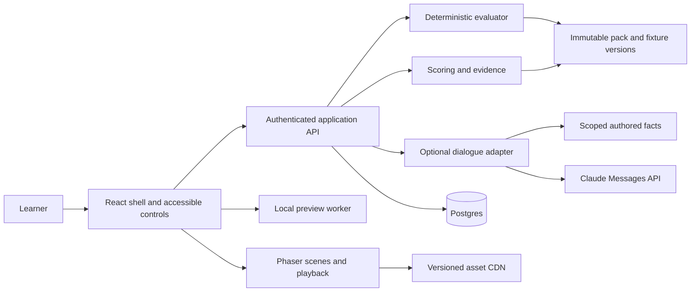

# E · Technical architecture

**Proposal · November 12, 2026**

> The current visual build uses Three.js and WebGL with a React/Next.js shell. This proposal records the original Phaser evaluation and the broader platform design. See the [visual build](visual-build.md) and [visual comparison](farmville-visual-audit.md) for the implemented rendering decision.

## Runtime shape

Build a modular TypeScript application with a React/Next.js DOM shell, a lazy-loaded Phaser 4 scene, shared deterministic simulation code and Postgres persistence. The system canvas renders a projection of state. The DOM owns forms, accessible actions, technical inspection and assessment. Use one deployment plus managed Postgres and object delivery for the slice. Features with distinct permission or throughput needs can be separated later without giving each module a network boundary today. [Next.js Route Handlers](https://nextjs.org/docs/app/getting-started/route-handlers), [Phaser 4 renderer](https://phaser.io/news/2026/04/phaser-4-renderer-faster-cleaner-and-built-for-modern-games), [PostgreSQL explicit locking](https://www.postgresql.org/docs/current/explicit-locking.html)



| Area | Starting choice | Alternative and decision point |
|---|---|---|
| App shell | Next.js and TypeScript with a client-only scene and semantic UI. Route handlers receive commands and return compact traces, feedback and save results. | Vite SPA plus a separate API is a good fit if static hosting and separate backend ownership matter more than a shared release. Keep core types and simulation modules framework-independent. [Next.js Route Handlers](https://nextjs.org/docs/app/getting-started/route-handlers), [Vite build docs](https://vite.dev/guide/build) |
| Rendering | Phaser 4/WebGL, textured sprites and baked shadows, manual footprint depth and scene transitions. HTML overlays remain anchored through scene-to-screen transform. | PixiJS 8 with custom scenes and timelines if render control or fit is better. Godot, Unity and 3D browser options are covered below. [Phaser 4](https://phaser.io/news/2026/04/phaser-4-renderer-faster-cleaner-and-built-for-modern-games), [PixiJS renderers](https://pixijs.com/8.x/guides/components/renderers) |
| Persistence and auth | Supabase managed Postgres and Auth with authenticated server commands, explicit access controls, and separate dev/staging/prod identities. Start with email-based sign-in or cohort invites and account deletion. | Managed Postgres plus a separate identity provider for enterprise SSO or existing organizational identity. Defer SSO until a pilot requires it. [Supabase RLS](https://supabase.com/docs/guides/database/postgres/row-level-security), [Database connections](https://supabase.com/docs/guides/database/connecting-to-postgres) |
| Content and assets | Git-reviewed source packs and signed release manifests with content hashes. CDN-hosted asset atlases. Keep held-out items in a server-only store. | Same-origin static delivery is enough for the first prototype. Use object storage/CDN when asset reuse and cache isolation matter. [JSON Schema 2020-12](https://json-schema.org/draft/2020-12), [R2 pricing](https://developers.cloudflare.com/r2/pricing/) |
| AI | Anthropic Messages API for optional stateless request/response with a short session window and authored fallback. Offline authoring uses the same source and review discipline. | Agent SDK for separately evaluated labs or a bounded authoring task with an actual orchestration need. Batch asynchronous authoring or eval at larger volumes. [Anthropic agent patterns](https://www.anthropic.com/research/building-effective-agents), [Message Batches](https://platform.claude.com/docs/en/build-with-claude/batch-processing) |
| Jobs | Synchronous bounded simulation, a simple Postgres due-date query for a delayed probe, a deployment scheduler or job process for opt-in notifications when needed. | Use a durable queue with retries and an outbox once a job must outlive requests or has material retry/backlog pressure. [Supabase database overview](https://supabase.com/docs/guides/database/overview), [Postgres locking](https://www.postgresql.org/docs/current/explicit-locking.html) |
| Analytics | First-party typed events, first-seen evidence and error/performance telemetry with distinct IDs, short retention and cohort aggregation. | Add managed observability and product analytics after privacy review and measured need. [OpenTelemetry JS](https://opentelemetry.io/docs/languages/js/), [Testing Standards](https://www.apa.org/science/programs/testing/standards) |
| Sales | Invoice early cohorts. Add hosted Stripe Checkout for self-service after pricing validation and process verified, idempotent webhooks for entitlements. | A team sales/billing platform is a later procurement-driven choice. [Stripe webhooks](https://docs.stripe.com/webhooks), [Stripe pricing](https://stripe.com/pricing) |

## Renderer selection and benchmark

| Candidate | Fit | Cost or risk |
|---|---|---|
| **Phaser 4** | Browser scenes, cameras, input, tweens and sprites support the district and cutaway with the fewest custom game utilities. Tiled supports isometric layout. Check the stable patch before pinning. | Newer renderer and WebGL-first features require Safari, context loss and device tests. Isometric occlusion and hit logic are still CertCity work. Phaser's renderer claims and shipped-game examples are feasibility evidence. [Renderer details](https://phaser.io/news/2026/04/phaser-4-renderer-faster-cleaner-and-built-for-modern-games), [Phaser releases](https://github.com/phaserjs/phaser/releases), [production showcase](https://phaser.io/games), [Tiled](https://github.com/mapeditor/tiled/blob/master/docs/manual/introduction.rst) |
| **PixiJS 8** | Strong sprite-first renderer with WebGL as the recommended default. Can integrate closely with a React-heavy product. | Plan to own world lifecycle, camera, interaction rules and timing explicitly. Current docs mark Canvas fallback experimental. [PixiJS renderer docs](https://pixijs.com/8.x/guides/components/renderers), [showcase](https://pixijs.com/showcase) |
| **Three.js / React Three Fiber** | An orthographic 3D scene supports cutaways, rotation and reusable rigs and materials when these matter. R3F supplies React integration and documented demand rendering and instancing strategies. | More geometry, lighting, asset and GPU variables. Scene math and accessible focus binding still need work. Prototype only the same scene and interaction. [Three.js orthographic camera](https://threejs.org/docs/#api/en/cameras/OrthographicCamera), [R3F performance](https://r3f.docs.pmnd.rs/advanced/scaling-performance) |
| **PlayCanvas** | Browser-first 3D, WebGL 2/WebGPU, editor and an inspectable showcase. Good if art/design iteration in a shared scene editor is the limiting factor. | Additional scene authoring/runtime surface. Compare editor collaboration, build export and custom accessible UI integration before adopting. [PlayCanvas engine](https://developer.playcanvas.com/user-manual/engine/), [project showcase](https://playcanvas.com/explore) |
| **Godot web** | A coherent 2D/3D editor, animation and cross-platform project if native distribution becomes important. | Browser export needs WebAssembly and WebGL 2. Threaded exports have additional cross-origin isolation constraints. A separate engine shell adds integration work for DOM-heavy assessment. [Godot web export](https://docs.godotengine.org/en/stable/tutorials/export/exporting_for_web.html) |
| **Unity Web** | Strong editor, animation and mature workflows for teams already shipping Unity assets. Current docs list some mobile-browser support. | Benchmark startup and memory on supported and unsupported configurations. Engine export and app/scene integration increase the first slice's delivery surface. [Unity browser compatibility](https://docs.unity.com/en-us/engine/6000.6/manual/platform-specific/webgl/intro/browsercompatibility) |

**Fair comparison.** Build one mixed-use city block and one interactive depot scene with the same silhouettes, camera limits, 3 staff sprites, 40 background props, 12 active trace markers and a representative texture budget. Start with Phaser and PixiJS for the same bakes. Build one 3D cutaway if the baseline misses a sightline, animation or pipeline target. Measure first meaningful scene, input-to-highlight, 95th-percentile frame time while running a shift, memory and context recovery. Use repeated cold and warm runs on Safari and Chromium on named devices, including a midrange phone, a lower-power laptop and one constrained network profile. Target ≤3 seconds to interactive under 10 Mbps/80 ms RTT for the initial scene, ≤100 ms input response, P95 frame time ≤33 ms on target mobile and ≤20 ms on target desktop. Give the DOM controls their own startup target and verify parity after WebGL failure. These are proposed budgets. No comparable cross-engine benchmark for this scene was found, and no production renderer measurements were run for this report. [Phaser renderer](https://phaser.io/news/2026/04/phaser-4-renderer-faster-cleaner-and-built-for-modern-games), [PixiJS docs](https://pixijs.com/8.x/guides/components/renderers), [R3F performance](https://r3f.docs.pmnd.rs/advanced/scaling-performance)

## Simulation and replay

**Authoritative evaluation.** A mission pack contains allowed commands and parameters, starting state, scenario policy, fixture workloads and ruleset version. A pure evaluator takes the pack version, scenario revision, engine version, policy draft and fixture seed. It returns a state snapshot, trace and measured outputs. For the first mission use deterministic cases in a finite batch and ordered discrete events. Define priority ties by simulation time, phase and case sequence. Use integer time and money in micro-units, explicit rounding at display, stable iteration, and a named seeded generator or authored fixture order. Use paired baselines with common input schedules. The server commits the run. A worker can render previews using public fixtures while hidden validation fixtures remain server-side. [SimPy event and resource model](https://simpy.readthedocs.io/en/latest/), [Web Workers](https://developer.mozilla.org/en-US/docs/Web/API/Web_Workers_API)

| Method | Fit and trigger |
|---|---|
| State machine + finite fixture replay | Start here. Makes prerequisites, allowed actions, terminal outcomes and counterfactual comparison explicit. |
| Discrete event queue + resource capacities | Extend when worker or service contention changes the decision. Reproduce congestion with seeded arrivals and ordering. |
| Clock tick | Works for visual interpolation and some continuous processes. Independent render time avoids making assessment depend on frame rate. |
| Agent-based institution | Consider when decisions depend on interacting actors, such as staffing behavior or shared demand. It multiplies calibration and debugging work. |
| Workflow engine or generic rules DSL | Consider after a second pack identifies recurring authoring pain. The slice uses validated declarative parameters and a few tested mechanic implementations. |
| LLM dynamics | Use only for presentation or candidate content drafts. Authoritative state, cost, failure outcomes and grading require reproducible rules. |

[SimPy](https://simpy.readthedocs.io/en/latest/), [OpenTTD mechanics](https://wiki.openttd.org/en/Manual/Game%20Mechanics/), [Anthropic agent patterns](https://www.anthropic.com/research/building-effective-agents)

**Command boundary.** A run request uses `attemptId`, `commandId`, `expectedRevision`, `policyDraft` and an allowed fixture selector. The service checks ownership, role and version, canonicalizes and hashes the request, and records a result under the unique pair `(attemptId, commandId)`. Reuse with different request content conflicts. A stale revision returns the new snapshot and an opportunity to rebase or repeat. For larger runs, compute outside a write transaction, then use a short compare-and-set or row lock at commit. Commit command receipt, events, snapshot and objective evidence together. Retries after a lost response return the stored result. Never let a stale preview overwrite a committed run. [PostgreSQL explicit locking](https://www.postgresql.org/docs/current/explicit-locking.html), [RFC 9110 HTTP semantics](https://www.rfc-editor.org/rfc/rfc9110.html)

**Tests.** Compare the model to golden fixture totals from [B](B-game-design.md). Property-test one terminal disposition per case, consistent count and money conservation, no disallowed payload disclosure, the retry ceiling, stable ordering and same input → same output. Test no-op baseline, surge, authorization block, stale revision, duplicate command, partial network loss and replay after pack publish. Hash canonical outcome data. Check visual trace separately. Never grade by the end state of an animation.

## Content and data

```yaml
packId: ccar-f
blueprintVersion: "1.0-2026-07"
contentVersion: "0.1.0"
engineContract: "1"
scenario:
  id: city-dispatch-lookup
  revision: 1
  mechanic: tool-result-routing
  objectives:
    - id: "2.2"
      role: primary
      evidenceRubric: tool-error-judgment-v1
  publicFixture: dispatch-preview-v1
  scoredFixtureSet: dispatch-holdout-v1
  modelAssumptions: dispatch-cost-v1
  assets: city-dispatch-v1
  lensPractice: museum-catalog-practice-v1
```

Use an immutable pack release plus normalized data for access and evidence. Publish workflow validates schema, source links and objectives, checks Lens and held-out exposure separation, compiles fixtures and runs golden traces. Require review from an SME and assessment editor before external release. Deploy a pack by atomically switching a current pointer. In-flight attempts keep their exact version. Rollback changes the pointer while preserving histories. An explicit equivalence table maps an old objective to an unchanged, revised or retired one. Revised objectives prompt fresh assessment. [JSON Schema 2020-12](https://json-schema.org/draft/2020-12), [1EdTech QTI](https://www.1edtech.org/standards/qti), [Testing Standards](https://www.apa.org/science/programs/testing/standards)

| Storage | Key fields and constraints |
|---|---|
| `profiles`, `cohorts`, `cohort_members`, `entitlements` | Auth subject, cohort membership and role; unique membership pair; optional entitlement with validity and originating order. |
| `pack_releases`, `objective_versions`, `scenario_revisions` | Pack ID/version, guide revision/effective date, objective ID and source page, immutable content hash, compat range and publication status. Foreign keys prevent dangling refs. |
| `attempts`, `run_commands`, `simulation_events` | Owner, scenario/version, seed, engine version, row revision, policy and result hash; unique attempt/command and attempt/sequence. Retain full traces for debugging within the retention window and bounded snapshots for replay. |
| `institution_progress` | Owner/institution, approved release and most recent accepted intervention, visible world state and impact portfolio. |
| `item_families`, `item_revisions`, `item_exposures` | Family, blueprint task, scenario cluster, form, difficulty plan, key/rubric, private visibility and review state; first-seen timing and assistance. Avoid indexing secrets into search or shipping answer keys to clients. |
| `learning_evidence`, `study_schedule` | Subject, objective version, evidence kind, source attempt, response result, item/family version, time, assistance, validity and review; idempotent submission ID. Index by subject/objective/version and next due date. |
| `dialogue_sessions`, `product_events` | Scenario/session references, pinned prompt/model version, fact IDs and usage totals; optional short-lived transcripts only when needed. Pseudonymize aggregated analytics where feasible. |

**Access model.** Validate identity and membership server-side on every command. Keep rubrics, private fixtures and keys in a schema unavailable to browser clients. Use least-privilege database roles and enable RLS on exposed tables. Use restrictive grants, private privileged functions with a controlled search path, security-invoker views where appropriate, and identity/tenant indexes for policies. A learner reads only their own history. Cohort staff see aggregate summaries and explicitly authorized learner fields. Authors edit draft content without access to learner transcripts. CI verifies a second tenant cannot read or mutate another tenant's records or objects. Use a pooled database connection appropriate to serverless access, regional co-location and forward/backward-compatible migrations. [Supabase RLS](https://supabase.com/docs/guides/database/postgres/row-level-security), [Supabase connection modes](https://supabase.com/docs/guides/database/connecting-to-postgres), [PostgreSQL row security](https://www.postgresql.org/docs/current/ddl-rowsecurity.html)

**Studio path.** Start with a repository pack, review templates, JSON Schema validation, coverage reports and a dev preview. Teach authors how to make a new variant with a bounded mechanic. Add a form-based authoring view when non-engineer SMEs hit specific blockers, then a publish flow with scoped roles, preview, provenance and automated comparison. Maintain explicit institution, mechanic, scenario and assessment boundaries. QTI is an interchange option for supported question types. It will not encode the playable city or institutional rules. [1EdTech QTI](https://www.1edtech.org/standards/qti), [JSON Schema](https://json-schema.org/draft/2020-12)

## Claude integration

Use a single Messages request for an optional stakeholder turn. The server selects authorized role facts, visible state and conversational context from a bounded window. Keep stable facts and citations by ID separate from summaries. Use schema-constrained output or a validated response envelope containing a short reply and referenced fact IDs. Citation validation catches unknown IDs. It cannot prove that generated text is entailed by a known fact. Critical metrics, requirements and actions render from authored fields and tool-free structured state. Use targeted evals and authored fallback for claims, latency or policy failures. [Anthropic context engineering](https://www.anthropic.com/research/effective-context-engineering-for-ai-agents), [Structured outputs](https://platform.claude.com/docs/en/build-with-claude/structured-outputs), [Anthropic evals](https://platform.claude.com/docs/en/test-and-evaluate/define-success)

- **Permissions.** The dialogue endpoint has no access to secrets, private assessment material, external URLs, arbitrary commands, live MCP servers or state-changing tools. Authored buttons and normal app commands perform actions. Treat model output and player text as untrusted, render text without executable markup and set input/output quotas. Cross-role evidence exposure and prompt injection resistance are evaluated as defensive behaviors. Store provider credentials server-side. Review vendor retention and applicable contracts before taking real customer data. [Anthropic security and legal resources](https://trust.anthropic.com/), [MCP security practices](https://modelcontextprotocol.io/specification/latest/basic/security_best_practices)
- **Model choice.** Test a current lower-cost model such as Haiku 5.5 against Sonnet 5.5 on role consistency, contradiction, evidence references, refusal handling and latency. Pin the deployed model and prompt versions. Use a stronger model only where the evaluation justifies it. Keep scripted answers if neither meets the test. Revalidate after model or provider changes. [Claude pricing and models](https://platform.claude.com/docs/en/about-claude/pricing), [Anthropic agent patterns](https://www.anthropic.com/research/building-effective-agents)
- **Time and cost.** Limit input history, use a per-mission turn cap and token budget, bound timeouts, and honor provider throttling. Retry only eligible upstream errors within deadline and avoid duplicate UI turns. Stream when it improves perceived latency and fits fact validation. Show authored evidence immediately on timeout. Enable prefix caching only after measuring qualifying prompt length and actual cache reads. Use Message Batches for authoring drafts and bulk evals with `custom_id` tracking, where completion can wait. [Rate limits](https://platform.claude.com/docs/en/api/rate-limits), [Caching](https://platform.claude.com/docs/en/build-with-claude/prompt-caching), [Batch processing](https://platform.claude.com/docs/en/build-with-claude/batch-processing)
- **Curriculum emulation.** Fixtures can represent Agent SDK traces, MCP envelopes, tool-choice constraints and model context behavior without invoking the represented services. For an optional runnable lab, use short-lived isolated instances with synthetic data, scoped resources and separate quotas after a need is demonstrated. Developer MCP access is detailed in [F](F-development-toolchain.md). [Claude tool use](https://platform.claude.com/docs/en/agents-and-tools/tool-use/how-tool-use-works), [MCP tools](https://modelcontextprotocol.io/specification/latest/server/tools)

## Assessment and readiness

Use evidence-centered design. Define the claim for each objective, what observable response would support it, and what task conditions make the inference defensible. Keep evidence types distinct: operational result, assisted practice, independent first-seen recognition, transfer in a different context, delayed retention, and runnable task performance where required. Require review of each original item and distractor for a plausible rationale, response-count fidelity, blueprint linkage, accessibility and leakage. Use deterministic scoring and a human-anchored rubric on a sample of open rationales. Retain item version and exposure history. [Mislevy, 1994](https://www.cambridge.org/core/journals/psychometrika/article/abs/evidence-and-inference-in-educational-assessment/592B899A2036FE7CDD48F2B0880E6F82), [Testing Standards](https://www.apa.org/science/programs/testing/standards)

**Pilot reporting.** Report numerator and denominator, concepts sampled, family/context coverage, elapsed time and uncertainty. Use all-or-nothing scoring for original multiple-response items in the pilot and store option-level evidence for feedback. An independent observation must be first-seen at the item-family level, without assistance, on a version-compatible item. Cluster scenario sets for analysis. The same item, paraphrase or reordered options cannot add new independent observations. Use a delayed form with changed case facts and a different scenario family. A useful objective-level label is “limited evidence” until it has two independent families including one delayed sample. Even then, show the sample size and avoid a claim of mastery from two correct answers. [Testing Standards](https://www.apa.org/science/programs/testing/standards), [Butler, 2010](https://pubmed.ncbi.nlm.nih.gov/20804289/), [Cepeda et al., 2008](https://pubmed.ncbi.nlm.nih.gov/19076480/)

**Candidate index after coverage.** For each objective, let `c` be correct first-seen independent family observations and `n` eligible observations, capped at one scored response per family. Estimate internal performance with `(c+0.5)/(n+1)` and show a wide beta interval when evidence is sparse. Calculate a domain mean over equally weighted planned objectives only once each objective meets coverage. Combine all five domains by `0.27, 0.18, 0.20, 0.20, 0.15` only once each meets coverage. Show withheld status for sparse or stale evidence. This is a proposed descriptive practice index. A simple beta interval assumes exchangeable independent responses and is illustrative before item dependence and difficulty are measured. Use cluster-aware resampling and validated form difficulty when data support them. Never map this index to the published 720 scaled score. [CCAR-F guide §§4 and 10](https://github.com/Amey-Thakur/CLAUDE-CERTIFICATIONS/blob/main/architect-foundations/exam-guide.pdf), [Testing Standards](https://www.apa.org/science/programs/testing/standards)

**Calibration.** Analyze item difficulty, distractor performance, discrimination, inter-rater agreement and subgroup and accessibility effects. Pilot classical test analysis before considering a Rasch or IRT model with adequate data. Once partner cohorts opt in, collect minimal external outcomes with consent, use temporally and organizationally held-out validation, report selection bias and attrition, and evaluate calibration and discrimination with uncertainty before considering a pass likelihood. Keep the predictor out of high-stakes employer decisions. [Testing Standards](https://www.apa.org/science/programs/testing/standards), [G · Study design](G-mvp-plan.md)

## Deployment, scale and costs

Run a stateless API in one region near the database with preview/staging environments and a rollback path. CDN assets are hashed and immutable. Keep a small initial scene, lazy load deeper views, and verify backups and recovery. Instrument P95 request time, run failure, scene load, cache rate, database saturation, inference tokens and fallback rate. Load-test run commits and dialogue separately. At 2,000 concurrent players, assuming 20% are in dialogue and request one turn every 40 seconds, expect about 10 dialogue requests/sec, 600 RPM, 1.32M input tokens/min and 180k output tokens/min before retries at the token assumptions below. At 2.5 seconds each that is roughly 25 active provider calls. Verify project limits and spike behavior before scaling or enrolling a large cohort. [Claude rate limits](https://platform.claude.com/docs/en/api/rate-limits), [Vercel pricing](https://vercel.com/pricing), [Supabase pricing](https://supabase.com/pricing), [R2 pricing](https://developers.cloudflare.com/r2/pricing/)

**Provider rates verified November 12.** Claude Haiku 5.5 lists $0.10 input / $0.50 output per million tokens at prompt lengths up to 100,000. Sonnet 5.5 lists $2 / $10 per million. An illustrative 90% Haiku / 10% Sonnet mix, 2,200 billed input and 300 billed output tokens per call, with no cache savings, is `(2,200 × 0.29 + 300 × 1.45) ÷ 1,000,000 = $0.001073` per dialogue turn. An all-Sonnet turn under the same budget costs $0.00740. Record actual billed usage including any thinking and retry overhead. The mix and token counts are hypotheses. [Claude pricing](https://platform.claude.com/docs/en/about-claude/pricing)

| Monthly scenario | Assumed sessions and turns | Inference at 90/10 | Inference at all Sonnet | Base and variable infrastructure |
|---|---:|---:|---:|---|
| 500 active pilot learners | 4 missions × 8 turns × 500 = 16,000 | $17.17 | $118.40 | One Vercel Pro seat and Supabase Pro start at $45/mo before metered usage. R2 Standard storage at 20 GB is $0.30 before free allowance. |
| 10,000 active learners | 4 × 8 × 10,000 = 320,000 | $343.36 | $2,368 | At 12 origin reads per session, 480,000 Class B reads list at $0.17 before free allowance. Profile API compute, database and logs. |
| 100,000 active heavy case | 8 × 12 × 100,000 = 9.6M | $10,300.80 | $71,040 | 9.6M origin reads list at $3.46 before allowance. Track bandwidth, provider and database quotas, cache misses and retries. Load test before estimating a full hosting bill. |

Base plans and R2 rates are published, while usage, any scale-up cost, support, payment processing, sales, observability, art and SME labor are estimates or excluded from the table. Keep asset delivery budgeted separately from database egress. At a modeled 8 MB of cold transfer per mission, the heavy case serves about 6.4 TB/month before client cache effects. R2 lists zero egress charges for R2 itself, while other connected services may charge. Model 20% dialogue retries as a stress test, separately from provider outages and scripted fallbacks. [Vercel pricing](https://vercel.com/pricing), [Supabase pricing](https://supabase.com/pricing), [R2 pricing](https://developers.cloudflare.com/r2/pricing/)

**Unit economics.** Measure hours per authored task, assessment item, technical release check and art variant. As a planning exercise, 30 objectives at 0.5–2 SME/assessment person-days each for design and review imply 15–60 person-days before game art, authoring implementation, validation and refresh. Start with two retained item families per objective and budget additional items for assessment forms and rotation. This estimate is intentionally rough and should be replaced with actual time from the slice. At small cohort sizes, even the all-Sonnet example leaves room for inference under reasonable allowances, while a few hours of support or procurement can dominate margin. Validate contribution per cohort after staffing, support, payment fees and content amortization. [Testing Standards](https://www.apa.org/science/programs/testing/standards), [Stripe pricing](https://stripe.com/pricing), [Claude pricing](https://platform.claude.com/docs/en/about-claude/pricing)
